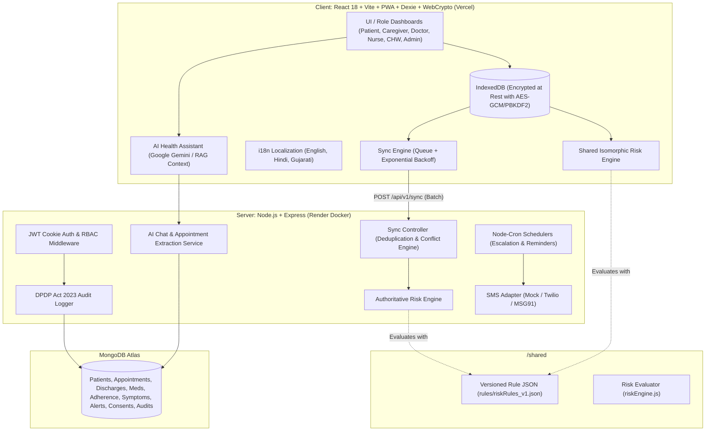

# HealthVerse

> **AI-Assisted Continuity-of-Care Platform for Post-Hospital Discharge**  
> *Engineered for rural and low-connectivity environments with offline-first PWA architecture, isomorphic clinical risk engine, and DPDP Act 2023 compliance.*

[](https://healthverse-six.vercel.app)
[](https://healthverse-n6kk.onrender.com/health)
[](LICENSE)
[](https://nodejs.org)
[](https://react.dev)

---

## 🌐 Live Production Deployment

- **Live Web Application (Vite PWA)**: [https://healthverse-six.vercel.app](https://healthverse-six.vercel.app)
- **Live Backend API (Render)**: [https://healthverse-n6kk.onrender.com](https://healthverse-n6kk.onrender.com)
- **Live API Health Check**: [https://healthverse-n6kk.onrender.com/health](https://healthverse-n6kk.onrender.com/health)
- **Live API / Swagger Documentation**: [https://healthverse-n6kk.onrender.com/api/docs](https://healthverse-n6kk.onrender.com/api/docs)
- **Production Architecture**:
  - **Frontend (Vercel)**: React 18 + Vite PWA with automatic service workers, IndexedDB offline caching, and reverse proxy rewrites (`/api/*` mapped to live Render backend).
  - **Backend (Render)**: Containerized Express.js application deployed via root `Dockerfile`, handling REST APIs, Node-Cron clinical schedulers, and Gemini AI assistant services.
  - **Database (MongoDB Atlas)**: Cloud database cluster with AES-256-GCM field encryption and DPDP Act 2023 compliant audit logs.

---

## ⚠️ SAFETY PRINCIPLE

> **The AI is a decision-support and early-warning tool only. It never diagnoses or prescribes. Every high or critical alert must be reviewed by a qualified clinician.**

---

## ✨ Key Capabilities & Recent Enhancements

### 1. 📅 Dedicated Clinician Patient Appointments Hub
- **Appointments Management Tab**: Clinicians have a dedicated tab on their dashboard with live counts for upcoming, completed, and cancelled patient consultations.
- **Consultation Completion Workflow**: Doctors can directly mark appointments as completed, attach visit notes, and record fresh prescriptions in a single modal flow.
- **Multi-Status Filtering**: Filter visits seamlessly across scheduled, completed, and cancelled states with real-time patient metadata.

### 2. 💊 Independent Clinical Action & Direct Prescribing
- **No Discharge Dependency**: Doctors can add medications and schedule follow-up appointments directly from the patient roster or detail view, without requiring an existing discharge summary document.
- **Rapid Medication Updates**: Direct medication adjustments and dosage changes reflected instantly in the patient's active adherence schedule.

### 3. 🤖 AI Health Assistant & Dynamic Appointment Booking (Google Gemini)
- **Personalized Clinical Context**: The AI assistant retrieves patient-specific clinical reports, active diagnoses, lab investigations, and prescription timelines to give context-aware continuity guidance.
- **Natural Language Appointment Booking**: Patients can converse naturally with the assistant (e.g., *"Book a follow-up visit with Dr. Ananya Sharma tomorrow at 3 PM"*); the AI extracts dates and times dynamically, validates clinician availability, and reserves the appointment.
- **Multilingual Support**: Supports queries in English, Hindi, and Gujarati with strict clinical safety guardrails.

### 4. 🔐 DPDP Act 2023 Compliant Authentication & Onboarding
- **Direct Password Provisioning**: User registration form includes explicit password setting with secure credential derivation via PBKDF2 (100,000 iterations).
- **Granular Consent Controls**: Patients grant and revoke access per purpose (`caregiver_access`, `chw_home_monitoring`, `emergency_sms_alerts`, `clinical_continuity`).

### 5. 🎨 High-Contrast Accessible UI & Dialog Redesign
- **Universal Modal Contrast**: Redesigned dialogs across Clinician Dashboard, CHW View, Admin View, and Consent Management with dark-mode accessibility and WCAG-aligned contrast.
- **Visual Alert Banners & Badges**: Urgent critical and high alerts feature animated badges and quick-action resolution dialogs.

---

## 🏛️ Architecture & Data-Flow



---

## 📦 Monorepo Layout

```
├── /client                 # React 18, Vite, Tailwind CSS, Dexie (IndexedDB), Zustand, PWA, Recharts, i18next
│   ├── src/components      # AIChatBot, RiskBadge, VitalsMonitor, AppointmentModals, Navigation
│   ├── src/pages           # ClinicianDashboard, PatientDetailView, CHWView, HospitalAdminView, LoginPage
│   ├── src/services        # IndexedDB (Dexie), WebCrypto client-side encryption, SyncEngine
│   └── vercel.json         # Vercel rewrites configuration routing /api to Render backend
├── /server                 # Node.js, Express, Mongoose, JWT (httpOnly), Helmet, Rate Limit, Winston, Node-Cron
│   ├── src/models          # Patient, Followup/Appointment, Prescription, Alert, DischargeSummary, AuditLog
│   ├── src/routes          # ai.routes, followup.routes, prescription.routes, patient.routes, sync.routes
│   ├── src/services        # aiChatService (Gemini), scheduler (Node-Cron), riskEngine, smsService
│   └── src/middleware      # auth, rbac, dpdpAudit, rateLimiter, errorHandler
├── /shared                 # Isomorphic rule-based risk engine and versioned JSON ruleset
│   ├── index.js            # Shared risk calculation logic
│   └── rules/              # riskRules_v1.json
├── Dockerfile              # Production Dockerfile for Render cloud deployment
├── .dockerignore           # Docker build ignore rules
├── vercel.json             # Root Vercel proxy configuration
├── docker-compose.yml       # Multi-container orchestration (MongoDB + Server + Client)
├── .env.example            # Environment configuration template
└── README.md               # Architecture, setup instructions, and demo credentials
```

---

## 🔑 Demo Logins (Default Password: `password123`)

| Role | Name | Phone / Login | Password | Focus Scenario |
| :--- | :--- | :--- | :--- | :--- |
| **Hospital Admin** | Dr. Ramesh Patel | `9800000001` / `admin@healthverse.local` | `password123` | Hospital analytics, staff management, DPDP audit trail |
| **Doctor 1** | Dr. Ananya Sharma | `9800000002` / `doctor1@healthverse.local` | `password123` | Internal Medicine, Discharges, Prescriptions, Appointments Tab, Alert Inbox |
| **Doctor 2** | Dr. Vikram Mehta | `9800000003` / `doctor2@healthverse.local` | `password123` | General Surgery, Post-op wound care, Critical alerts |
| **Nurse 1** | Sister Priya Nair | `9800000004` / `nurse1@healthverse.local` | `password123` | In-person follow-ups, triage, lab sample tracking |
| **Nurse 2** | Sister Meena Desai | `9800000005` / `nurse2@healthverse.local` | `password123` | Emergency & triage, patient observations |
| **CHW / ASHA** | Sunita Devi | `9800000006` / `chw@healthverse.local` | `password123` | Field visits, offline patient registration & symptom logging |
| **Patient 1** | Rajesh Verma | `9800000011` | `password123` | Post-PCI MI Recovery (High Alert for missed critical meds) |
| **Patient 5** | Devendra Solanki | `9800000015` | `password123` | Severe Pneumonia (Critical Alert: SpO2 90% + Fever) |
| **Caregiver 1** | Amit Verma | `9800000020` / `caregiver1@healthverse.local` | `password123` | Linked to Patient 1 with active DPDP consent |

---

## 🚀 Quickstart & Local Setup

### Prerequisites
- **Node.js** (v18+ or v20+)
- **MongoDB** (running locally or MongoDB Atlas connection URI)

### 1. Install Dependencies
```bash
# Install root, server, and client dependencies
npm run install:all
```

### 2. Configure Environment
Copy `.env.example` to `server/.env`:
```bash
cp .env.example server/.env
```

Ensure MongoDB URI and Gemini API Key are configured:
```env
PORT=5000
MONGODB_URI=your_mongodb_connection_string
GEMINI_API_KEY=your_gemini_api_key_here
CLIENT_ORIGIN=http://localhost:5173
```

### 3. Seed Database
Seeds 1 Demo Hospital, 6 Clinical Staff, 10 Realistic Patients with clinical histories, open alerts, scheduled appointments, and multilingual education guides:
```bash
npm run seed
```

### 4. Run Development Servers
```bash
# Runs backend on port 5000 and Vite PWA client on port 5173 concurrently
npm run dev
```
- **Web App**: [http://localhost:5173](http://localhost:5173)
- **API Server & Health Check**: [http://localhost:5000/health](http://localhost:5000/health)
- **OpenAPI / Swagger Docs**: [http://localhost:5000/api/docs](http://localhost:5000/api/docs)

---

## 📱 Offline-First & Sync Engine Architecture

1. **Local IndexedDB Persistence (Dexie)**: All writes (medication adherence, symptom reports, CHW patient registrations, visit notes) are written to IndexedDB first with `syncStatus = 'pending'`, and enqueued in `db.syncQueue`.
2. **At-Rest Encryption via Web Crypto API**: Sensitive patient logs are encrypted in IndexedDB using `AES-GCM` with a 256-bit key derived via `PBKDF2` (100,000 iterations) from the authenticated user's credentials.
3. **Optimistic UI with Indicators**: Records display a visible pulsing `Not synced` badge until confirmed by the server. A global network bar displays live online/offline state.
4. **Batch Sync (`POST /api/v1/sync`)**:
   - Deduplicated by `clientUuid`.
   - **Append-only logs** (adherence, symptoms) merged cleanly.
   - **Clinician-owned data** (prescriptions, discharge schedules, investigation results) always takes precedence from the server.
   - **Patient profile edits** resolve via Last-Write-Wins (LWW) comparing `updatedAt`, logging any conflict in `SyncLog`.
5. **Auto-Reconnection**: Listens to the browser's `online` event and retries with exponential backoff.

---

## 🛡️ India DPDP Act 2023 Alignment

HealthVerse adheres directly to the statutory principles of India's Digital Personal Data Protection Act 2023:
1. **Specific Purpose Limitation**: Consent is captured per specific purpose (`caregiver_access`, `chw_home_monitoring`, `emergency_sms_alerts`, `clinical_continuity`).
2. **Right to Withdraw**: Patients can revoke consent at any time from the UI with immediate access termination. Revocation is recorded with reasons and never deletes records to preserve accountability.
3. **Field-Level Encryption**: Sensitive patient health fields (medical history, eligibility, address, contact) are encrypted at rest in MongoDB using AES-256-GCM.
4. **Immutable Audit Trail**: Every access (read, write, update, revoke consent, sync) is logged in the `AuditLog` collection with user ID, IP address, user agent, and timestamp.

---

## 🧪 Automated Testing

```bash
# Run unit tests (Risk Engine, Sync Conflicts) and API tests (Auth & RBAC)
npm run test:server
```
