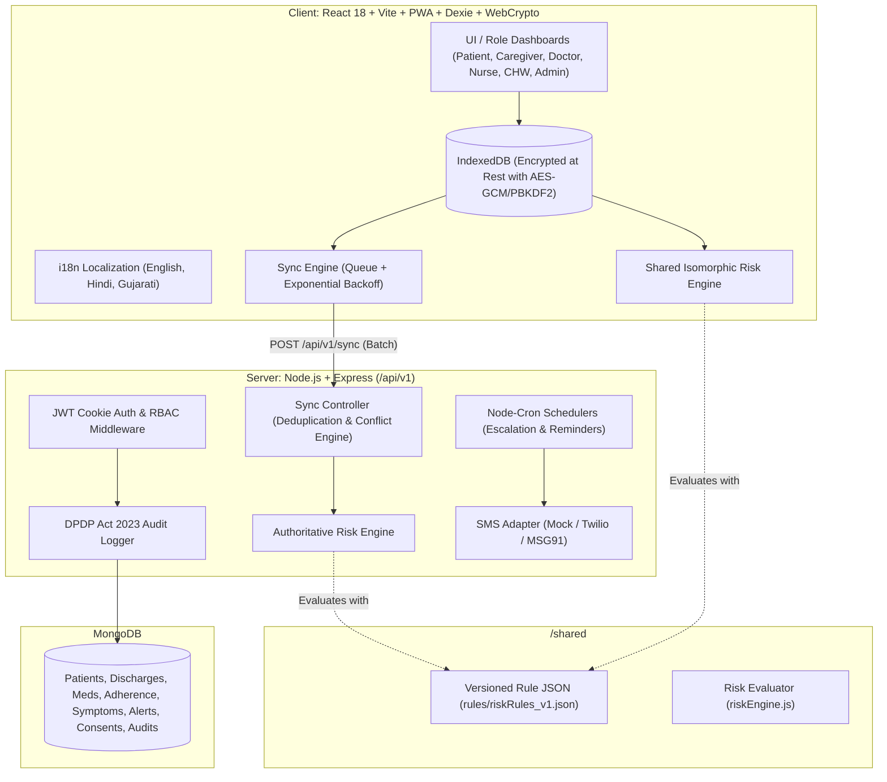

# HealthVerse

> **AI-Assisted Continuity-of-Care Platform for Post-Hospital Discharge**  
> *Engineered for rural and low-connectivity environments with offline-first PWA architecture, isomorphic clinical risk engine, and DPDP Act 2023 compliance.*

---

## ⚠️ SAFETY PRINCIPLE

> **The AI is a decision-support and early-warning tool only. It never diagnoses or prescribes. Every high or critical alert must be reviewed by a qualified clinician.**

---

## 🏛️ Architecture & Data-Flow



---

## 📦 Monorepo Layout

```
├── /client         # React 18, Vite, Tailwind CSS, Dexie (IndexedDB), Zustand, PWA, Recharts, i18next
├── /server         # Node.js, Express, Mongoose, JWT (httpOnly), Helmet, Rate Limit, Winston, Node-Cron
├── /shared         # Isomorphic rule-based risk engine and versioned JSON ruleset
├── docker-compose.yml # Multi-container orchestration (MongoDB + Server + Client)
├── .env.example    # Template for environment configuration
└── README.md       # Architecture, setup instructions, and demo credentials
```

---

## 🔑 Demo Logins (Default Password: `password123`)

| Role | Name | Phone / Login | Password | Focus Scenario |
| :--- | :--- | :--- | :--- | :--- |
| **Hospital Admin** | Dr. Ramesh Patel | `9800000001` / `admin@healthverse.local` | `password123` | Hospital analytics, staff management, DPDP audit trail |
| **Doctor 1** | Dr. Ananya Sharma | `9800000002` / `doctor1@healthverse.local` | `password123` | Internal Medicine, Discharges, Prescriptions, Alert Inbox |
| **Doctor 2** | Dr. Vikram Mehta | `9800000003` / `doctor2@healthverse.local` | `password123` | General Surgery, Post-op wound care, Critical alerts |
| **Nurse 1** | Sister Priya Nair | `9800000004` / `nurse1@healthverse.local` | `password123` | In-person follow-ups, triage, lab sample tracking |
| **Nurse 2** | Sister Meena Desai | `9800000005` / `nurse2@healthverse.local` | `password123` | Emergency & triage, patient observations |
| **CHW / ASHA** | Sunita Devi | `9800000006` / `chw@healthverse.local` | `password123` | Field visits, offline patient registration & symptom logging |
| **Patient 1** | Rajesh Verma | `9800000011` | `password123` | Post-PCI MI Recovery (High Alert for missed critical meds) |
| **Patient 5** | Devendra Solanki | `9800000015` | `password123` | Severe Pneumonia (Critical Alert: SpO2 90% + Fever) |
| **Caregiver 1** | Amit Verma | `9800000020` / `caregiver1@healthverse.local` | `password123` | Linked to Patient 1 with active DPDP consent |

---

## 🚀 Quickstart & Local Setup

### Prerequisites
- **Node.js** (v18+ or v20+)
- **MongoDB** running locally on `localhost:27017`

### 1. Install Dependencies
```bash
# Install root, server, and client dependencies
npm run install:all
```

### 2. Configure Environment
Copy `.env.example` to `server/.env`:
```bash
cp .env.example server/.env
```

### 3. Seed Database
Seeds 1 Demo Hospital, 6 Clinical Staff, 10 Realistic Patients with clinical histories, open alerts, and multilingual education guides:
```bash
npm run seed
```

### 4. Run Development Servers
```bash
# Runs backend on port 5000 and Vite PWA client on port 5173
npm run dev
```
- **Web App**: [http://localhost:5173](http://localhost:5173)
- **API Server & Health Check**: [http://localhost:5000/health](http://localhost:5000/health)
- **OpenAPI / Swagger Docs**: [http://localhost:5000/api/docs](http://localhost:5000/api/docs)

---

## 📱 Offline-First & Sync Engine Architecture

1. **Local IndexedDB Persistence (Dexie)**: All writes (medication adherence, symptom reports, CHW patient registrations, visit notes) are written to IndexedDB first with `syncStatus = 'pending'`, and enqueued in `db.syncQueue`.
2. **At-Rest Encryption via Web Crypto API**: Sensitive patient logs are encrypted in IndexedDB using `AES-GCM` with a 256-bit key derived via `PBKDF2` (100,000 iterations) from the authenticated user's credentials.
3. **Optimistic UI with Indicators**: Records display a visible pulsing `Not synced` badge until confirmed by the server. A global network bar displays live online/offline state.
4. **Batch Sync (`POST /api/v1/sync`)**:
   - Deduplicated by `clientUuid`.
   - **Append-only logs** (adherence, symptoms) merged cleanly.
   - **Clinician-owned data** (prescriptions, discharge schedules, investigation results) always takes precedence from the server.
   - **Patient profile edits** resolve via Last-Write-Wins (LWW) comparing `updatedAt`, logging any conflict in `SyncLog`.
5. **Auto-Reconnection**: Listens to the browser's `online` event and retries with exponential backoff.

---

## 🛡️ India DPDP Act 2023 Alignment

HealthVerse adheres directly to the statutory principles of India's Digital Personal Data Protection Act 2023:
1. **Specific Purpose Limitation**: Consent is captured per specific purpose (`caregiver_access`, `chw_home_monitoring`, `emergency_sms_alerts`, `clinical_continuity`).
2. **Right to Withdraw**: Patients can revoke consent at any time from the UI with immediate access termination. Revocation is recorded with reasons and never deletes records to preserve accountability.
3. **Field-Level Encryption**: Sensitive patient health fields (medical history, eligibility, address, contact) are encrypted at rest in MongoDB using AES-256-GCM.
4. **Immutable Audit Trail**: Every access (read, write, update, revoke consent, sync) is logged in the `AuditLog` collection with user ID, IP address, user agent, and timestamp.

---

## 🧪 Automated Testing

```bash
# Run unit tests (Risk Engine, Sync Conflicts) and API tests (Auth & RBAC)
npm run test:server
```
